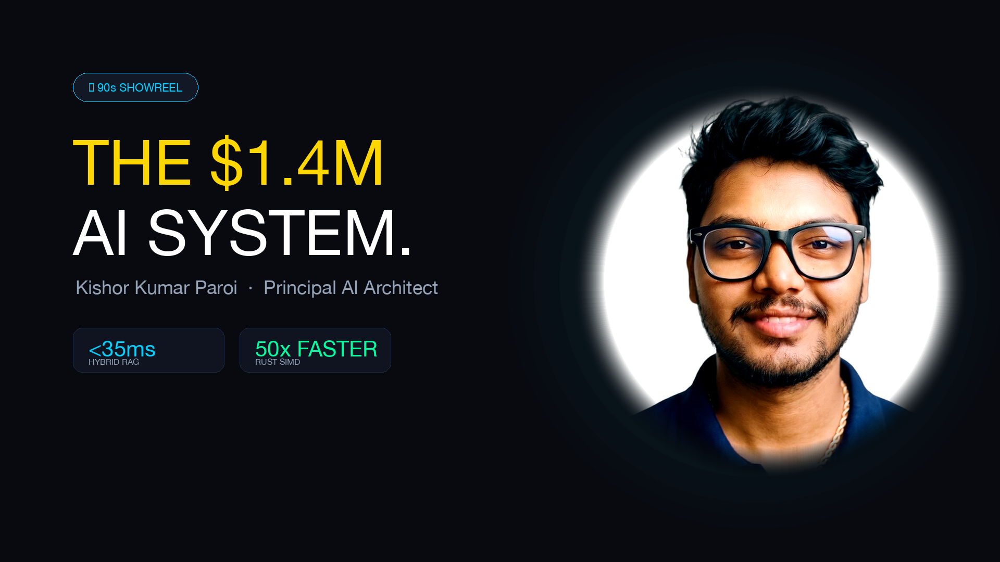

# 💎 The $10,000 Executive AI Pitch Deck (Widescreen 16:9)

<div align="center">

[](https://pptx.kishor.tech)
[](https://www.youtube.com/watch?v=mqX-2FW3o0Q)
[](https://pptx.kishor.tech/Kishor_Kumar_Paroi_10000_Dollar_Executive_Deck.pptx)
[](https://pptx.kishor.tech)
[](https://pptx.kishor.tech)

<br/>

<a href="#-quick-links--interactive-viewers"><strong>⚡ Jump Directly to Online Viewers & Architecture Breakdown Below ↓</strong></a>

<br/>



</div>

---

## ⚡ Quick Links & Interactive Viewers

| Destination | Format | Description |
| :--- | :--- | :--- |
| **🌐 Web Presentation Hub** | **[pptx.kishor.tech](https://pptx.kishor.tech)** | Official widescreen portal with embedded live viewers, telemetry benchmarks, and downloads. |
| **👁️ Microsoft PowerPoint Online** | **[Open in Office Online](https://view.officeapps.live.com/op/view.aspx?src=https%3A%2F%2Fpptx.kishor.tech%2FKishor_Kumar_Paroi_10000_Dollar_Executive_Deck.pptx)** | Zero-download interactive cloud viewer powered by Microsoft Office Online. |
| **📄 Google Slides / Docs Viewer** | **[Open in Google Docs](https://docs.google.com/viewer?url=https%3A%2F%2Fpptx.kishor.tech%2FKishor_Kumar_Paroi_10000_Dollar_Executive_Deck.pptx)** | Seamless browser inspection with zero downloads required. |
| **🎬 4K Cinematic Video Reel** | **[Watch on YouTube (4K 60FPS)](https://www.youtube.com/watch?v=mqX-2FW3o0Q)** | 90-second high-impact systems architecture walkthrough: multi-agent mesh, Rust SIMD, and vLLM. |
| **⬇️ Direct Local PPTX** | **[Download .pptx (5.3 MB)](https://pptx.kishor.tech/Kishor_Kumar_Paroi_10000_Dollar_Executive_Deck.pptx)** | Full widescreen 16:9 presentation file for boardroom offline presentations and technical diligence. |

---

## 🎯 Executive Overview

Authored by **Kishor Kumar Paroi** (Principal AI Systems Architect & Founder @ KoomAI), this presentation delivers a bespoke, boardroom-ready architectural breakdown covering:
* **Production AI Systems & Latency Rigor**: Sub-35ms Hybrid RAG, 50x Rust SIMD vector pre-filtering, and 99.4% autonomous agent precision.
* **All 15 Flagship System Blueprints**: High-resolution topology diagrams, detailed 4-pillar technical bullet points, and verified ROI metrics across every project.
* **Dual-Track Career Trajectory**: Experience at phi0.ai ($1.4M contracts won), Samsung AI Core, kepi.ai, and academic pedigree (RUET CSE Rank 483rd nationwide, ICPC contestant).
* **Enterprise Cloud & Economics**: Medallion Lakehouses (Snowflake, PySpark Delta Lake, Feast <5ms Redis), vLLM Multi-LoRA dynamic multiplexing (-68% GPU spend), and ArgoCD GitOps.

---

## 📐 24-Slide Architectural Deck Structure

| Slide | Category | Title & Core Highlights |
| :---: | :--- | :--- |
| **01** | **Hero Cover** | **Apple Keynote Minimalist Studio Cover** &bull; Full-bleed studio lighting with celestial cyan glow. |
| **02** | **Executive Hero** | **Kishor Kumar Paroi — Identity & Verified Production Rigor** &bull; $1.4M ARR, <35ms RAG, 50x Rust, 99.4% precision. |
| **03** | **Resume & Pedigree** | **Executive Resume & Dual-Track Trajectory** &bull; phi0.ai, Samsung AI Core, kepi.ai, RUET CSE, and competitive DSA honors. |
| **04** | **Systems Thesis** | **The 4 Production AI Pillars** &bull; Sub-35ms Retrieval, Multi-LoRA vLLM, Zero-Trust NeMo Defense, and Medallion Lakehouses. |
| **05** | **Telemetry Wall** | **Executive Benchmarks & Cost Cuts** &bull; Native vector progress bars (12x faster P95, 88% cheaper tokens, 90x faster feature lookup). |
| **06** | **Flagship 01** | **Zomato AI Lakehouse & Dispute Platform** &bull; 35M+ orders, PySpark Delta Lake, Snowflake, Feast <5ms Redis, dHash CV fraud arbitration. |
| **07** | **Flagship 02** | **Hybrid Anime Intelligence & Continuous LLMOps** &bull; Go/Rust/FastAPI polyglot mesh, 50x SIMD speedup, vLLM Multi-LoRA multiplexing. |
| **08** | **Flagship 03** | **Founder Showcase: KoomAI ($24K MRR)** &bull; Sub-150ms WebRTC media engine, 20-agent LangGraph mesh, Next.js 15, desktop & extension. |
| **09** | **Flagship 04** | **Enterprise AI Security & Production RAG Gateway** &bull; BotShield WAF, NVIDIA NeMo Guardrails, PyRIT 95%+ attack block, Portkey cache <35ms. |
| **10** | **Flagship 05** | **Smart Manufacturing Industrial AI & Edge MLOps** &bull; Rust SIMD vibration pre-filter, PyTorch autoencoders, TensorRT INT8 (<8.2ms), ArgoCD GitOps. |
| **11** | **Flagship 06** | **Nexus-AI Multi-Cloud Lakehouse & Agent Mesh** &bull; AWS/GCP/Azure Delta Lake, LangGraph 4-agent mesh (NL2SQL/BI/MLOps), Go 1.22 gateway. |
| **12** | **Flagship 07** | **Network Security Azure Medallion Lakehouse** &bull; ADF ingestion, ADLS Gen2, Synapse serverless CETAS (-58% cost), Power BI DirectQuery. |
| **13** | **Flagship 08** | **AWS SageMaker End-to-End MLOps Pipelines** &bull; Automated DAG pipelines, Feature Store, Model Registry, Canary rollouts, Clarify drift monitoring. |
| **14** | **Flagship 09** | **Cloud-Native KServe Serving & Scale-to-Zero** &bull; Scale-to-zero serverless inference on K8s (-72% idle GPU spend), Triton/vLLM runtimes, Istio mTLS. |
| **15** | **Flagship 10** | **Production AI Chatbot & Human-in-the-Loop** &bull; LangGraph stateful graph with MemorySaver, HITL break-glass approval gates, 100% audit logging. |
| **16** | **Flagship 11** | **Autonomous Data Agent — Multi-Agent BI Engine** &bull; Hierarchical agent graph (Planner, Schema Introspector, Validator), zero scan crashes, self-healing SQL. |
| **17** | **Flagship 12** | **Core Systems: Rust Git Engine & Async POSIX Shell** &bull; Bare-metal Git DAG in Rust, streaming zlib SIMD decompression, async shell with <1µs latency. |
| **18** | **Flagship 13** | **3D Cyber Hacker Cockpit & Interactive WebGL** &bull; Three.js, custom GLSL bloom shaders, real-time WebSocket cyber threat telemetry at 60 FPS. |
| **19** | **Flagship 14** | **MacOS Sequoia Interactive Desktop Web OS** &bull; Next.js 15, Framer Motion window physics, Zustand store, interactive Terminal, Web Audio API. |
| **20** | **Flagship 15** | **Interactive 3D Space Station Digital Twin** &bull; WebGL space station twin, orbital physics simulation, sensor fusion telemetry HUD, mobile 60 FPS. |
| **21** | **Advantage** | **Value Differentiation Matrix** &bull; Direct side-by-side comparison: Typical Senior Engineers vs Kishor's full-stack systems engineering rigor. |
| **22** | **Engagement** | **Target Roles & Collaboration Models** &bull; Principal AI Systems Architect, FDE, Executive Advisory, High-Impact 90-Day Sprints. |
| **23** | **Roadmap** | **90-Day Strategic Impact Playbook** &bull; Phase 1: Days 1–30 (Audit & Quick-Win ROI); Phase 2: Days 31–60 (Mesh & Lakehouse); Phase 3: Days 61–90 (GitOps Scale). |
| **24** | **Closing Outro** | **Vantage Retro Synthwave Anime Crest** &bull; Distinct closing slide with 80s anime aesthetic, holographic cyberdeck, and direct contact gateways. |

---

## 🛠️ Build & Reproducibility Instructions

The deck is deterministically generated via Python without external GUI dependencies:

```bash
# 1. Activate dedicated Python environment with python-pptx and Pillow
source /Users/kishorkumarparoi/Desktop/AI_Sequrity/8hr-MARATHON/.venv/bin/activate

# 2. Run master generator
python generate_master_deck.py

# 3. Output files generated:
#  - Kishor_Kumar_Paroi_10000_Dollar_Executive_Deck.pptx (5.32 MB)
#  - pitch_deck.pptx (5.32 MB)
#  - deck.pptx (5.32 MB)
```

---

## 🌐 Ecosystem & Author Information

* **Portfolio:** [kishor.tech](https://kishor.tech)
* **KoomAI:** [koom.kishor.tech](https://koom.kishor.tech)
* **macOS Portfolio:** [macos.kishor.tech](https://macos.kishor.tech)
* **LinkedIn:** [linkedin.com/in/kishor-kumar-paroi-b06344166](https://linkedin.com/in/kishor-kumar-paroi-b06344166)
* **Email:** [kishor.ruet.cse@gmail.com](mailto:kishor.ruet.cse@gmail.com)

